<p align="center">
  
</p>

<br>

### `01` &nbsp;Sobre mí

Me gusta entender las cosas de punta a punta, desde la interfaz que usa la gente hasta el servidor donde corre, y meterme en proyectos interesantes que ofrezcan soluciones reales.

Buena parte de lo que aprendo sale de mi homelab: tres Lenovo Tiny en Docker Swarm donde monto, rompo y arreglo servicios, hosteo servidores de juegos y tengo Pi-hole para toda la red, todo accesible desde fuera con Tailscale.

```yaml
intereses: [desarrollo de apps, web, backend, sistemas, self-hosting, impresión 3D]
```

<br>

### `02` &nbsp;Stack

<table>
  <tr>
    <td width="130"><b>Lenguajes</b></td>
    <td></td>
  </tr>
  <tr>
    <td><b>Front &amp; Back</b></td>
    <td></td>
  </tr>
  <tr>
    <td><b>DevOps</b></td>
    <td>
      <br>
      
      
      
      
    </td>
  </tr>
  <tr>
    <td><b>Sistemas</b></td>
    <td>
      <br>
      
      
    </td>
  </tr>
  <tr>
    <td><b>Herramientas</b></td>
    <td></td>
  </tr>
</table>

<br>

### `03` &nbsp;Proyectos

| Proyecto | De qué va | Stack |
|:--|:--|:--|
| **[Yovi](https://github.com/Arquisoft/yovi_es2b)** | Juego de tablero con arquitectura de microservicios para Arquitectura del Software. Pipelines CI/CD, tests E2E con Playwright y Cucumber, cobertura en SonarCloud e imágenes Docker publicadas en GHCR. |     |
| **Predictor Engine** <br><sub><code>work&nbsp;in&nbsp;progress</code></sub> | Sistema experto que predice el podio de carreras de salto de obstáculos. Combina simulaciones Monte Carlo con heurísticas propias: ranking FEI de caballo y jinete, forma reciente, sinergia jinete-caballo y estado de la pista. Probado contra Grandes Premios 5\* reales. |   |

<br>

### `04` &nbsp;Homelab

Tres Lenovo ThinkCentre M700 Tiny en un clúster Docker Swarm donde levanto contenedores para hostear servidores de juegos (Farming Simulator, Minecraft y Euro Truck Simulator 2), Pi-hole para bloquear publicidad en toda la red y un contenedor de almacenamiento que hace de nube propia.

<p align="center">
  
</p>

<br>

### `05` &nbsp;Actividad

<picture>
  <source media="(prefers-color-scheme: dark)" srcset="https://raw.githubusercontent.com/iyaniglesias/iyaniglesias/output/github-snake-dark.svg">
  <source media="(prefers-color-scheme: light)" srcset="https://raw.githubusercontent.com/iyaniglesias/iyaniglesias/output/github-snake.svg">
  
</picture>

<p align="right"><sub><code>~ $ exit</code></sub></p>
